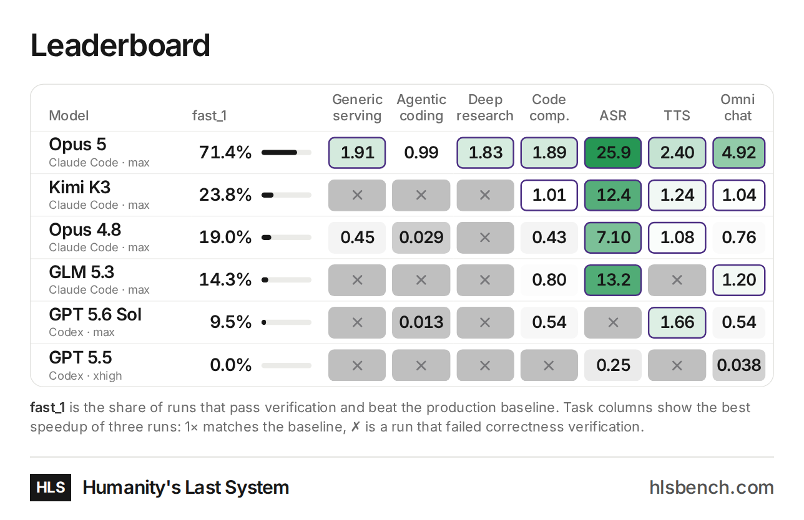

# Humanity's Last System

Steven&nbsp;Gao<sup>1</sup>, Rulin&nbsp;Shao<sup>1</sup>, Keisuke&nbsp;Kamahori<sup>1</sup>, Yuetai&nbsp;Li<sup>1</sup>,
Yufei&nbsp;Gao<sup>1</sup>, Atindra&nbsp;Jha<sup>2</sup>, Junjie&nbsp;Oscar&nbsp;Yin<sup>1</sup>, Shihang&nbsp;Li<sup>1</sup>,
Radha&nbsp;Poovendran<sup>1</sup>, Jure&nbsp;Leskovec<sup>2</sup>, Hannaneh&nbsp;Hajishirzi<sup>1</sup>,
Pang&nbsp;Wei&nbsp;Koh<sup>1</sup>, Luke&nbsp;Zettlemoyer<sup>1</sup>, Stephanie&nbsp;Wang<sup>1</sup>, Baris&nbsp;Kasikci<sup>1</sup>

<sup>1</sup>University&nbsp;of&nbsp;Washington, <sup>2</sup>Stanford&nbsp;University

[](https://hlsbench.com)
[](https://hlsbench.com/blog/introducing-hls)
[](https://hlsbench.com/traces)
[](LICENSE)

Would you bet that a coding agent could write an inference engine from scratch in 12 hours and
beat vLLM? The best agents already can. Opus 5's servers passed verification and beat the
production baseline in 71% of its runs, with speedups of up to 25.9× on speech recognition and
4.9× on omni chat. The next best model did so in 24% of runs, and no model produced a correct
server on every attempt.

Humanity's Last System (HLS) is the ultra-long-horizon agentic coding benchmark behind those
numbers. Each task gives an agent a live GPU sandbox, with up to 8 H200s and up to 36 hours, and
asks it to build a serving system specialized to one model, one hardware platform and one
production workload. HLS then deploys the agent's final commit in a fresh container, runs the
task's timed workload against it, checks the outputs against a trusted reference, and scores its
speed against a baseline. A server that fails the check scores zero.

[](https://hlsbench.com)

The [introduction](https://hlsbench.com/blog/introducing-hls) describes the tasks, the verifiers
and our results, and [hlsbench.com](https://hlsbench.com) has the leaderboard and over 150 agent
trajectories.

## What you need

- A Slurm cluster with Apptainer, or one Linux host with Docker and NVIDIA GPUs.
- [uv](https://docs.astral.sh/uv/). [bun](https://bun.sh/) too, if you want the result viewer.
- For your first run: one GPU (H200, H100, B200, A100, L40 or L40S), 8 CPUs, 68 GiB of memory and
  225 GiB of free local disk. The seven benchmark tasks need H200s.
- An API key for the model the agent runs on, and a Hugging Face token.

## Install

```sh
git clone --recurse-submodules https://github.com/humanityslastsystem/hls
cd hls
uv sync
```

## Configure

HLS reads two files: `hls.toml` in the checkout, which says where jobs run and which agent builds,
and a secrets file that holds your keys.

On a Slurm cluster, `hls.toml` looks like this:

```toml
[site]
partition = "gpu"                            # the Slurm partition with your GPUs
store_root = "/shared/hls/store"             # where HLS keeps images, weights, data and results; on a shared filesystem
node_scratch = "/tmp"                        # a local disk on each node
secrets_path = "~/.config/hls/secrets.toml"

[routes.anthropic]
credential = "anthropic_key"                 # the name of your API key in the secrets file

[arms.claude]                                # the agent that builds: Claude Code on Claude Opus 5
harness = "claude-code"
model = "claude-opus-5"
context_window = 1000000
output_limit = 64000
route = "anthropic"
```

On a Docker host, replace the `[site]` table with this one:

```toml
[site]
substrate = "docker"
store_root = "/data/hls/store"
node_scratch = "/data/hls/scratch"
secrets_path = "~/.config/hls/secrets.toml"
local.state_dir = "/data/hls/state"          # where the host's job scheduler keeps its records
local.kept_memory_gib = 16                   # memory left for the host itself; jobs get the rest
```

The secrets file names each key once. The `[grants]` table gives the Hugging Face token to the
step that downloads model weights:

```toml
[secrets]
anthropic_key = "sk-ant-xxxxxxxxxxxxxxxx"
hf_token = "hf_xxxxxxxxxxxxxxxxxxxx"

[grants]
"stage.provision".HF_TOKEN = "hf_token"
```

```sh
chmod 600 ~/.config/hls/secrets.toml
```

## Run

```sh
uv run hls run tasks.sample_task.task --arm claude
```

This runs one full round of the benchmark on the sample task, which serves a 0.5B model and gives
the agent at most an hour. HLS downloads the model and data, builds the container images, starts
the agent in its sandbox, then packages, serves, verifies and scores what the agent committed. The
sample task asks for an H200; on other GPUs, name yours after the task, for example
`--task.hardware.accelerator.kind=L40S`.

The command prints the run's name and follows it to the end:

```text
instance runs/sample_task/<id>
...
runs/sample_task/<id>: succeeded: every stage published
runs/sample_task/<id>: score <value> (<path of score.json in the store>)
```

If you stop the command, the run keeps going. `uv run hls status runs/sample_task/<id>` shows
where it is, and `uv run hls resume runs/sample_task/<id>` follows it again.
`uv run hls view` serves a web page of every run in the store.

The seven benchmark tasks run the same way; [docs/tasks.md](docs/tasks.md) lists them. Before the
first run of multitenant_slo, tab_completion, multimodal_tts or agentic_coding, assemble the
reference library their agents read, once per checkout:

```sh
uv run python scripts/assemble_references.py
```

## Documentation

| Page | What it covers |
|---|---|
| [docs/running.md](docs/running.md) | A run from start to end, arms and routes, budgets, watching and controlling a run, grading an existing submission, the results |
| [docs/commands.md](docs/commands.md) | Every `hls` command and its options |
| [docs/setup-slurm.md](docs/setup-slurm.md) | Setting up a Slurm cluster |
| [docs/setup-docker.md](docs/setup-docker.md) | Setting up a Docker host |
| [docs/configuration.md](docs/configuration.md) | Every key of `hls.toml` and the secrets file |
| [docs/tasks.md](docs/tasks.md) | The seven tasks: what the agent builds, the model, the hardware, the workload |
| [docs/scoring.md](docs/scoring.md) | What a score means and how to read a record |
| [docs/adding-a-task.md](docs/adding-a-task.md) | Writing a task |
| [docs/wire-protocol.md](docs/wire-protocol.md) | The HTTP contract between the harness and a submission's server |
